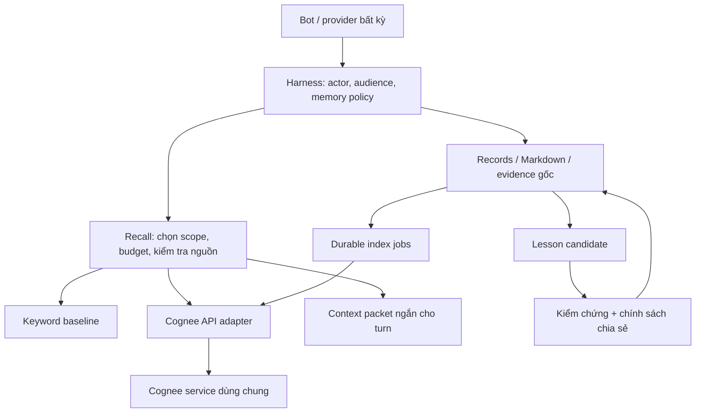

# Cognee memory và shared learning cho OpenMausBot

Ngày: 2026-11-01. Trạng thái: **TẠM DỪNG theo yêu cầu; chỉ giữ bản thiết kế, không triển khai Cognee hay memory dự án**.
Người dùng yêu cầu lên plan trước khi triển khai. Tài liệu này bổ sung và ưu tiên
thứ tự triển khai so với [plan project context](2026-11-01-cognee-project-context-memory.md).
Phạm vi trước mắt là lớp memory trong OpenMausBot hiện tại; không xây hệ orchestration mới.

## 1. Mục tiêu và giới hạn

1. Giảm context gửi lặp lại, số lần đọc lại tài liệu và số vòng gọi tool để tìm kiến thức cũ.
2. Truy hồi đúng thông tin, có nguồn và revision; không trộn private memory vào pool chung.
3. Model nhỏ dùng lại cách giải quyết đã được model mạnh tạo ra và được kiểm chứng.
4. Đổi provider/restart vẫn giữ kiến thức; Cognee lỗi thì các chức năng đang có tiếp tục dùng được.

“Học” ở đây là retrieval + playbook + ví dụ đã kiểm chứng. Không cập nhật trọng số
model và không lưu chuỗi suy luận nội bộ. Không coi nhãn model mạnh là bằng chứng đúng.
Một kết quả sai của model mạnh không được trở thành bài học cho cả pool.

Không mặc định index toàn bộ chat, source tree hoặc log tool. Chỉ index nguồn được
chọn trong scope đã cấp. Không tăng bộ tool mặc định chỉ để phục vụ memory.

## 2. Hiện trạng đã đọc trong checkout

| Hiện có | Điểm tích hợp / điều cần giữ |
| --- | --- |
| `server/memory-store.ts`, `server/workspace.ts` | Markdown riêng bot, atomic write, hash/conflict, journal; giữ làm nguồn gốc |
| `server/recall.ts` | Keyword recall, topic aliases; budget hiện tại 6.000 ký tự; giữ làm baseline/fallback |
| `server/index.ts::autoRecallPrompt` | Recall đang đồng bộ, dùng ở direct chat và room với phạm vi khác nhau |
| `server/index.ts` tạo system prompt | `MEMORY.md`, shared notes, team memory, recent work, skills/playbooks đã có thể chiếm context trước recall |
| `server/team-memory.ts` | Accepted/proposed/superseded/deleted + revision; kind hiện tại chỉ person/place/decision/term |
| `server/drivers/agents-catalog.ts`, `agents-call.ts` | Đã có `memory_update`, `memory_log`, `session_search`, `propose_team_memory` |
| `server/drivers/agents-mcp-env.ts` | MCP bridge theo bot/thread/turn; dùng tiếp thay vì mở quyền truy cập Cognee trực tiếp |
| `server/config.ts` | `memory` hiện chỉ có capture timing/tidy hour; chưa có cấu hình Cognee |
| `server/memory-layer.e2e.test.ts` | Fixture launcher và fake engine để kiểm tra plumbing; không chứng minh chất lượng model thật |

Working tree đang có nhiều thay đổi chưa commit, gồm memory, provider và process.
Trước từng task triển khai phải kiểm tra lại diff và file ownership; không ghi đè
các thay đổi đó. Danh sách trên là khảo sát source, không phải kết quả runtime mới.

## 3. Kiến trúc chọn



Một backend Cognee nhận truy cập qua API. Các bot gọi MCP bridge của OpenMausBot;
harness quyết định scope và chuyển yêu cầu. Không để mỗi CLI mở cùng embedded DB.
Không đưa backend credential hoặc công cụ xóa toàn bộ Cognee cho bot.

Cognee API Mode hỗ trợ chia sẻ backend, nhưng một MCP process dùng một backend
token thì các tool không mang identity riêng của từng bot. Dataset chỉ tổ chức dữ
liệu; không tự tạo cách ly giữa các client dùng chung token.
[Nguồn: Cognee API Mode](https://docs.cognee.ai/cognee-mcp/mcp-local-setup#running-in-api-mode).

Quyền đọc phải được áp trước truy vấn. Không query chung private datasets rồi mới
lọc câu trả lời đã tổng hợp: graph synthesis có thể đã đưa private facts vào output.
MVP ưu tiên truy hồi có source IDs và render từ record gốc đã kiểm tra; không inject
câu trả lời tổng hợp không truy được nguồn. Nếu bản pin không hỗ trợ mức truy hồi
này, compatibility probe phải chỉ rõ adapter cần dùng API thấp hơn nào.

## 4. Phân vùng memory

| Scope | Nội dung | Chính sách |
| --- | --- | --- |
| Private bot | Ghi chú riêng, sở thích và context có audience giới hạn | Dùng audience/layer hiện có; không tự đưa vào shared pool |
| Project | Decisions, constraints, docs, checkpoint, kết quả có revision | Thành viên dự án; ID bất biến, không lấy cwd làm identity |
| Shared pool | Lesson và tool playbook tái sử dụng | Chỉ cho nhóm người/bot được cấp; không phải kho public toàn hệ thống |
| Session | Việc đang làm, step hiện tại, pending action | Runtime/checkpoint là nguồn gốc; không tự nâng thành tri thức bền |

Pool có `poolId`, thành viên và quyền read/write/publish riêng. Bot thuộc nhiều
pool chỉ nhận các pool được phép trong turn đó. Lesson chuyển private → project
→ pool phải tạo bản rút gọn đã loại dữ liệu riêng; không đổi scope của raw transcript.
Dataset ID do harness map, không nhận dataset tùy ý từ model.

Record dùng lại identity/revision/source/status của plan project context; bổ sung
`lesson` và `toolPlaybook` bằng contract riêng. Không ép lesson nhiều bước vào
field `detail` 600 ký tự của team memory hiện tại.

## 5. Model nhỏ học cách xử lý như thế nào

Model mạnh kết thúc một task có thể đề xuất một lesson ngắn theo contract:

```text
id, scope, poolId?/projectId?, revision, status
problem, trigger, prerequisites, steps[], alternatives[], failureModes[]
verification { checks[], evidenceRefs[] }
example { input, expectedOutcome }
provenance { botId, provider, model, threadId, runId?, sourceRefs[] }
compatibility { tool?, server?, schemaHash?, version?, environment? }
createdAt, lastVerifiedAt, expiresAt?, supersedes?
```

`steps` biểu diễn hành động công khai: “nếu điều kiện A thì làm B; nếu thất bại C
thì kiểm tra D”. Không lưu reasoning token, transcript dài, API key hoặc đường dẫn
máy cá nhân vào lesson chung. Giữ evidence gốc trong scope ban đầu; bản shared
chỉ trỏ tới evidence mà người đọc có quyền, hoặc bằng chứng tái lập đã được công bố.

Vòng đời: proposed → kiểm chứng → accepted; sửa tạo revision mới và supersede cũ;
có thể expired/deleted. Tách evidence verification khỏi quyền publish. Dùng
acceptance policy hiện có; không thêm bước owner duyệt cho mỗi lần bot làm việc.
MVP không có tự động publish bài học chỉ dựa vào lời bot “đã thành công”.

Luồng sử dụng:

1. Task mới → tìm lesson theo vấn đề + môi trường + tool đang dùng.
2. Model nhỏ nhận tối đa vài lesson phù hợp: điều kiện áp dụng, bước xử lý, ví dụ,
   cách kiểm tra và nguồn; không nhận toàn bộ lịch sử của model mạnh.
3. Harness kiểm tra tool/schema/quyền hiện tại trước khi thực thi; lesson không cấp quyền.
4. Nếu không khớp điều kiện, kiểm tra thất bại hoặc lặp lỗi vượt ngưỡng cấu hình,
   chuyển về coordinator/model mạnh theo routing hiện có, kèm tóm tắt thử nghiệm.
5. Kết quả thực thi cập nhật số lần áp dụng thành công/thất bại có evidence.
   Không tăng độ tin cậy chỉ vì lesson được đọc nhiều lần.

Tool playbook lưu tình huống dùng, MCP server/tool, input mẫu đã bỏ secret,
pre/postconditions, schema hash, lỗi thường gặp và cách phục hồi. Trước call phải
đối chiếu catalog thật; schema đổi thì đánh stale và kiểm chứng lại. Call đã tạo
side effect không được retry chỉ vì lesson nói retry; dùng receipt/idempotency
và policy hiện có. MCP auth, health và khả năng tool là live state, không phải memory fact.

## 6. Giảm token theo cơ chế nào

Không chỉ thêm Cognee bên cạnh prompt cũ: cách đó có thể tăng token và chi phí.
Tách chế độ đo `baseline`, `shadow` và `compact`:

- Baseline: hành vi hiện tại, làm mốc so sánh.
- Shadow: truy hồi Cognee để đo nhưng không inject thêm vào prompt; tắt khi hết thử nghiệm.
- Compact: giữ core/pinned memory, truy hồi có chọn lọc phần dài; thay thế phần
  context tương ứng thay vì nối thêm cùng thông tin từ nhiều nguồn.

Core memory vẫn giữ standing constraints và thông tin bắt buộc. Không cắt cứng
`MEMORY.md` hiện có hoặc chọn “N dòng đầu” làm compact mode. Cần record kind/pin
hoặc quy tắc migration người dùng xem được; thiếu phân loại thì giữ baseline.

Packet dùng summary đã lưu + source ID/revision + cách lấy chi tiết khi cần.
Không gọi model để viết lại query hoặc summarize lại mỗi lượt. Dedupe cùng nguồn,
gộp private/project/shared retrieval vào một budget thay vì cấp budget riêng rồi cộng.

Ngân sách thử nghiệm: packet recall tối đa 1.200 token ước tính, top 3 lesson,
deadline recall warm 1,5 giây; các giá trị này cần benchmark. Ước tính token phải
ghi rõ phương pháp; dùng usage thực tế của provider để báo hiệu quả cuối cùng.
Không biến giới hạn ký tự thành số token chính xác cho tiếng Việt và code.

Đo cả input, output, cached input, tool output và helper/extraction/embedding cost;
so sánh theo task hoàn tất, không chỉ theo một turn ngắn. Context stable bị sửa có
thể mất cache, nên đo cached tokens/cost trước khi đổi cách đặt memory trong prompt.
Chỉ gửi packet mới hoặc nội dung thay đổi khi cơ chế resume/provider cho phép;
fresh/recovery vẫn phải dựng đủ context. Không rút gọn lịch sử bằng cách làm mất
tool-call/result pairing, task acceptance hoặc outstanding handoff.

## 7. Ghi, sửa, xóa và sự cố

Ghi nguồn gốc trước, durable index job sau bằng journal/outbox có recovery; báo
`saved/indexing/indexed/failed` riêng. Idempotency theo record ID + revision + hash.
Index background, retry có backoff và giới hạn; không chặn chat vì graph chưa sẵn sàng.
Model extraction và embedding có cấu hình/cost budget riêng; CLI subscription
không được mặc nhiên coi là API credential cho Cognee.

Session memory upstream có thể bridge vào permanent graph theo cấu hình. Adapter
phải kiểm soát đường này, không cho raw session tự bypass bước kiểm chứng/publish.
[Nguồn: Remember](https://docs.cognee.ai/core-concepts/main-operations/remember).

Sau await recall, direct/room turn phải kiểm tra lại claim/cancellation, memory
enabled, membership và revision trước dispatch. Cache theo scope, policy version
và source revisions; không chỉ theo query/model. Tắt memory hoặc đổi quyền phải
ngừng inject ở turn đang chuẩn bị, không đợi cache hết hạn.

Forget tạo tombstone trước, chặn recall và retry index ngay, rồi xóa graph/vector/
session cache theo API thực tế. Không trả lại record đã xóa từ keyword fallback,
cache hoặc restore backup. Ghi rõ phạm vi xóa raw file/history/backup; upstream
forget không mặc nhiên xóa mọi raw upload trên disk.
[Nguồn: Forget](https://docs.cognee.ai/core-concepts/main-operations/forget).

## 8. Plan triển khai và gate

Các task chưa được giao cho agent khác. Không sửa runtime cho đến khi người dùng
yêu cầu triển khai sau bản plan này. Mỗi task phải có phạm vi diff và evidence riêng.

| Bước | Deliverable cụ thể | Gate để qua bước |
| --- | --- | --- |
| M0 — Baseline | Corpus giả, task/query IDs, đo context composition và usage theo task; bộ đề model nhỏ có/không lesson | Có số đo lặp lại được; phân biệt byte/token estimate/provider usage |
| M1 — Cognee probe | Pin release/image, fixture service riêng, model/embedding config explicit; round trip ingest → recall source → delete → restart | Xác nhận API/schema/auth/scope/source mapping, resource cost; không dùng tag main |
| M2 — Storage + adapter | Contract scopes/pools/lessons, records + durable jobs + adapter; hồi phục revision/tombstone/outage | Test concurrent write, restart, retry, revoke, delete offline; không rò private |
| M3 — Read path | Bounded async retrieval, automatic recall direct/room, fallback; shadow rồi compact mode | Packet đúng audience, không duplicate, cancel/Stop không dispatch muộn; benchmark so baseline |
| M4 — Shared learning + MCP | Submit/validate/publish lesson và playbook; tích hợp search/read vào bridge hiện có | Bot B tìm được lesson accepted của A nhưng không thấy transcript riêng; schema stale không thực thi mù |
| M5 — Provider + model nhỏ | Native MCP smoke từng provider đang hỗ trợ; bài task held-out có/không lesson | Bằng chứng tool thực gọi, usage và chất lượng model thật; fake không thay thế live |
| M6 — Controls + rollout | Cấu hình off/shadow/compact, chọn nguồn/pool, trạng thái index, sửa/quên/export; migration và rollback | Người dùng xem nguồn/quyền được; disable/rebuild/restore không mất record hoặc hồi sinh fact đã quên |

Thứ tự code: M0 → M1 → M2 → M3 → M4 → M5 → M6. Không triển khai full project
registry, UI graph explorer, multi-worker hay database cluster trước compatibility
probe. Project identity cần hoàn tất trước khi bật project memory; shared learning
có thể thử riêng trong pool fixture với membership explicit.

Reuse `memory_update`, `session_search` và cơ chế proposal. Contract lesson khác
fact nên chỉ thêm tool chuyên biệt khi catalog probe xác nhận cần; search trả summary,
read trả detail theo ID. Schema ít tool và progressive disclosure là yêu cầu cho
model nhỏ. Chưa chốt tên tool để tránh trùng catalog đang thay đổi.

## 9. Nghiệm thu và đo hiệu quả

Theo [verification README](../verification/README.md): launcher fixture với temporary
HOME/data, port explicit, corpus và Cognee store riêng. Không ingest chat, key hoặc
project thật để kiểm chứng mutation. Lưu lệnh, log, source IDs, revision và kết quả.

| Nhóm | Case bắt buộc |
| --- | --- |
| Recall | Paraphrase tiếng Việt/Anh, tool error/code, no hit, stale version, contradiction, source đúng |
| Quyền | Bot/pool/project khác; restricted room; thu hồi membership trong lúc recall; synthesis không lẫn private |
| Vòng đời | Sửa race, delete khi offline, job retry, restart harness/Cognee, rebuild, restore với tombstone |
| Runtime | Direct chat, room, handoff, provider switch/resume; timeout/Stop và claim bị thay trong lúc await |
| Learning | Model nhỏ áp dụng đúng lesson, nhận ra prerequisites không khớp, fallback khi fail, không tin lesson giả |
| MCP | Schema/version đổi, auth hết hạn, bridge restart, tool unavailable, side effect không bị gọi lặp |

Đề xuất mốc MVP, **chưa phải kết quả đã đạt**:

- Bộ 30 query cố định: recall@5 đúng nguồn ≥ 90%; 0 hit trái scope/deleted/superseded.
- Bộ ít nhất 20 task held-out, cùng model và cấu hình: mục tiêu giảm ≥ 25% tổng
  input tokens/task; pass rate không giảm so baseline. Báo task hoàn tất và thất bại riêng.
- Model nhỏ cùng bộ đề: so không memory / baseline / shared lessons; báo pass rate,
  số lần gọi model mạnh, tool calls và tổng cost. Không đặt phần trăm cải thiện
  trước khi biết baseline; cần lặp lại các task có biến thiên, không kết luận từ một demo.
- Đo ingestion cost + amortization theo số lần reuse, p50/p95 recall, RAM/disk,
  cached-input cost và thời gian end-to-end. Chưa có lợi ích ròng thì giữ opt-in.

Tách evidence thành deterministic fixture, Cognee thật với corpus giả, native CLI
loopback và model/provider thật. Không gọi mock test xanh là “model nhỏ đã học”.

## 10. Phạm vi đã hoàn tất ở lượt lập plan

Đã khảo sát source và đối chiếu tài liệu upstream để chốt kiến trúc, luồng learning,
cách đo token và gate triển khai. Chưa cài dependency, chạy Cognee, thay memory của
bot hoặc benchmark model. Bước thực thi đầu tiên sau khi được yêu cầu là M0/M1.

## 11. Tiến độ triển khai (2026-11-01)

- M1 một phần: `cognee==1.6.6` cài được trong venv Python 3.12 riêng (1,1 GB). Đã xác nhận
  `remember/recall/forget/add/cognify/search/delete` và tham số `datasets`, `dataset_ids`,
  `only_context`, `include_references`; auth + multi-tenant mặc định bật. **Chưa chạy round trip**:
  máy không có API key LLM/embedding và Ollama chưa có model nào.
- M2 phần lõi, chưa nối vào runtime, tắt mặc định: `server/project-memory.ts` (record, revision,
  tombstone, outbox bền, supersede, rebuild) và `server/project-memory-recall.ts` (cổng `SemanticIndex`,
  kiểm hit với record gốc, deadline, fallback keyword). Test: `server/project-memory.test.ts` với index giả.
- Còn lại: adapter Cognee thật, M0 benchmark, M3 trở đi.
